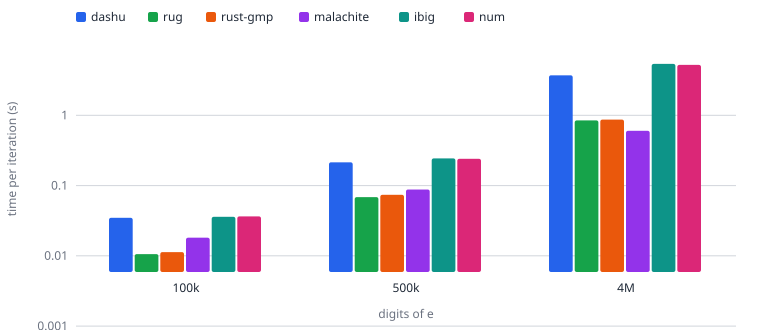
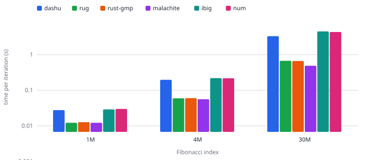
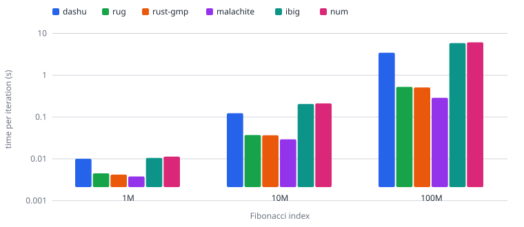
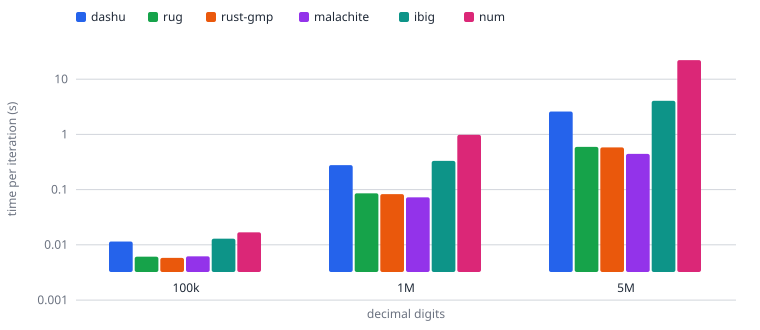
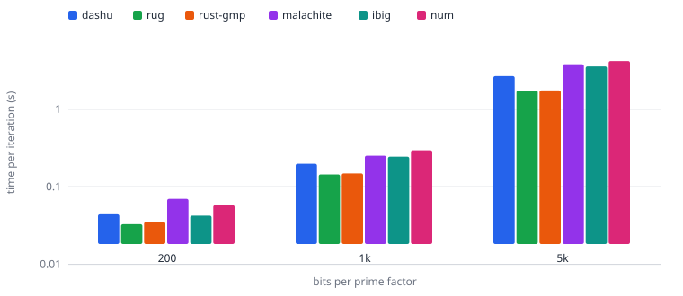
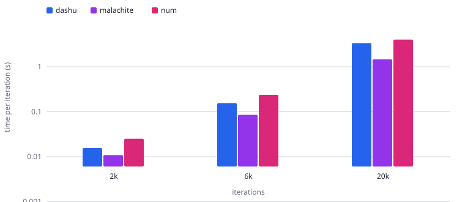
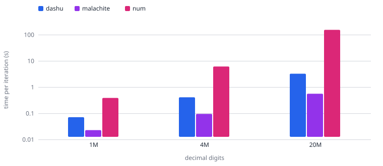
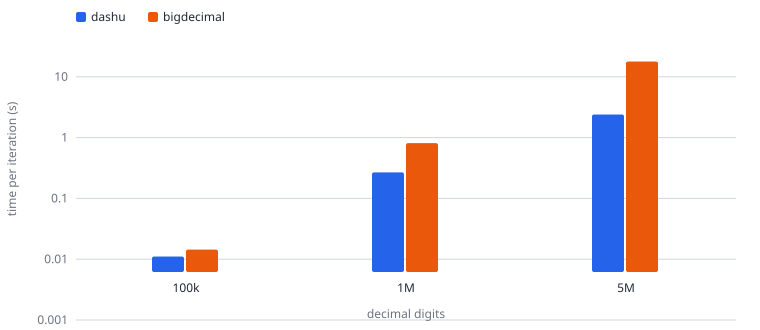
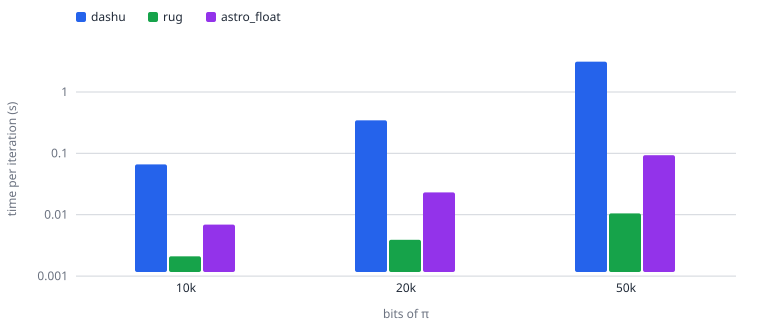

# Library comparison report

Generated 2026-10-18 23:55:14 by `benchmark/run.py`. Times are seconds for one task iteration (lower is better); cells under 1 s are the minimum of 3 process runs, and the factor task excludes its one-time prime generation. The fastest library per size is in bold.

## Environment

| | |
| --- | --- |
| OS | Pop!_OS 24.04 LTS · Linux 7.1.5-76070105-generic x86_64 |
| CPU | AMD Ryzen 5 7535U with Radeon Graphics (12 threads) |
| Memory | 14.8 GiB |
| Rust | rustc 1.98.1 (48a229cea 2026-09-01) |
| GMP | 6.3.0 (rug / rust-gmp backends) |

## e

Input size unit: digits of e.

| n | dashu | rug | rust-gmp | malachite | ibig | num |
| --- | --- | --- | --- | --- | --- | --- |
| 100k | 0.035 | **0.011** | 0.011 | 0.018 | 0.036 | 0.036 |
| 500k | 0.214 | **0.069** | 0.074 | 0.088 | 0.244 | 0.240 |
| 4M | 3.71 | 0.846 | 0.868 | **0.601** | 5.38 | 5.21 |

## fib

Input size unit: Fibonacci index.

| n | dashu | rug | rust-gmp | malachite | ibig | num |
| --- | --- | --- | --- | --- | --- | --- |
| 1M | 0.028 | **0.012** | 0.013 | **0.012** | 0.029 | 0.030 |
| 4M | 0.196 | 0.059 | 0.060 | **0.056** | 0.218 | 0.217 |
| 30M | 3.29 | 0.669 | 0.660 | **0.485** | 4.47 | 4.30 |

## fib_hex

Input size unit: Fibonacci index.

| n | dashu | rug | rust-gmp | malachite | ibig | num |
| --- | --- | --- | --- | --- | --- | --- |
| 1M | 0.010 | 0.004 | 0.004 | **0.004** | 0.011 | 0.011 |
| 10M | 0.123 | 0.037 | 0.037 | **0.029** | 0.205 | 0.212 |
| 100M | 3.44 | 0.525 | 0.510 | **0.288** | 5.83 | 6.11 |

## io_int

Input size unit: decimal digits.

| n | dashu | rug | rust-gmp | malachite | ibig | num |
| --- | --- | --- | --- | --- | --- | --- |
| 100k | 0.011 | 0.006 | **0.006** | 0.006 | 0.013 | 0.017 |
| 1M | 0.279 | 0.086 | 0.083 | **0.073** | 0.331 | 0.983 |
| 5M | 2.60 | 0.593 | 0.582 | **0.444** | 4.07 | 22.2 |

## factor

Input size unit: bits per prime factor.

| n | dashu | rug | rust-gmp | malachite | ibig | num |
| --- | --- | --- | --- | --- | --- | --- |
| 200 | 0.044 | **0.033** | 0.035 | 0.070 | 0.042 | 0.058 |
| 1k | 0.198 | **0.144** | 0.148 | 0.252 | 0.244 | 0.295 |
| 5k | 2.68 | **1.74** | 1.74 | 3.80 | 3.56 | 4.19 |

## fib_ratio

Input size unit: iterations.

| n | dashu | malachite | num |
| --- | --- | --- | --- |
| 2k | 0.015 | **0.011** | 0.025 |
| 6k | 0.156 | **0.085** | 0.237 |
| 20k | 3.37 | **1.46** | 4.02 |

## io_ratio

Input size unit: decimal digits.

| n | dashu | malachite | num |
| --- | --- | --- | --- |
| 1M | 0.072 | **0.023** | 0.393 |
| 4M | 0.416 | **0.097** | 6.22 |
| 20M | 3.32 | **0.569** | 157 |

## io_decimal

Input size unit: decimal digits.

| n | dashu | bigdecimal |
| --- | --- | --- |
| 100k | **0.011** | 0.014 |
| 1M | **0.268** | 0.814 |
| 5M | **2.40** | 17.8 |

## pi

Input size unit: bits of π.

| n | dashu | rug | astro_float |
| --- | --- | --- | --- |
| 10k | 0.066 | **0.002** | 0.007 |
| 20k | 0.345 | **0.004** | 0.023 |
| 50k | 3.11 | **0.011** | 0.093 |

## Interactive chart

The interactive version of the above (task switching, library toggles, tooltips) is in [chart.html](report/chart.html); raw timings are in [results.json](report/results.json) (git-ignored).
